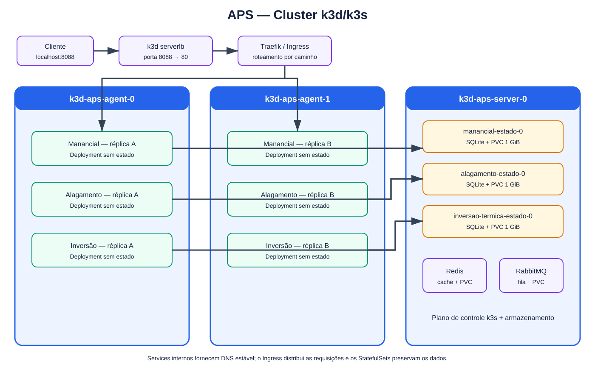

# Arquitetura atual do cluster

O ambiente ativo usa k3d para executar k3s dentro do Docker Desktop. O k3s fornece o
Kubernetes, o Traefik, o metrics-server e a classe de armazenamento `local-path`.

## Caminho de uma requisição

1. O cliente acessa `127.0.0.1:8088`.
2. `k3d-aps-serverlb` entrega a conexão ao Traefik.
3. O Ingress escolhe o Service pelo prefixo da URL.
4. O Service balanceia entre os pods do Deployment, nos agentes 0 e 1.
5. O pod de atendimento usa DNS interno para chamar o Service headless do domínio.
6. O StatefulSet processa a leitura, publica SSE, cria alertas e grava no SQLite do PVC.

O Manancial, o Alagamento e a Inversão Térmica têm estado independente. Assim, cada banco
fica no respectivo pod de estado e todos os pods replicáveis daquele domínio apontam para o
mesmo endereço interno estável.

## Distribuição por nó

| Nó | Função e cargas |
|---|---|
| `k3d-aps-server-0` | plano de controle, Traefik, três StatefulSets SQLite, Redis e RabbitMQ |
| `k3d-aps-agent-0` | uma réplica de cada API |
| `k3d-aps-agent-1` | uma réplica de cada API |
| `k3d-aps-serverlb` | contêiner do k3d que publica a porta 8088; não é nó Kubernetes |

O servidor é propositalmente o ponto único dos dados neste laboratório. A queda de um
agente preserva o atendimento no outro. A queda do servidor interrompe o plano de controle
e o acesso aos bancos locais até o nó voltar; alta disponibilidade de banco exigiria outra
arquitetura de armazenamento e replicação.
