# Experimentos de carga APS

Medições pelo Ingress local. Atendimento Java replicável; coordenador SQLite/fila único por domínio. O ganho mede a camada HTTP, não a replicação do banco nem da coordenação.

As latências de POST medem o aceite HTTP 202. A confirmação no SQLite e a drenagem da fila estão em eventos.jsonl. Na escrita síncrona, a resposta aguarda o commit. Essas garantias são diferentes e precisam acompanhar a comparação.

| Execução | Clientes | Requisições | OK/s | p50 ms | p95 ms | p99 ms | Erros % |
|---|---:|---:|---:|---:|---:|---:|---:|
| assincrono/assincrona | 16 | 2236 | 63.56 | 203.23 | 496.56 | 626.48 | 0.00 |
| assincrono/sincrona | 16 | 1527 | 43.38 | 299.64 | 760.92 | 1096.17 | 0.00 |
| base/get-1 | 1 | 1217 | 81.12 | 7.19 | 31.06 | 59.99 | 0.00 |
| base/get-1 | 2 | 2701 | 180.01 | 6.70 | 29.92 | 51.73 | 0.00 |
| base/get-1 | 4 | 2762 | 183.48 | 9.96 | 67.46 | 85.56 | 0.00 |
| base/get-1 | 8 | 2776 | 183.90 | 18.35 | 96.16 | 116.99 | 0.00 |
| base/get-1 | 16 | 2573 | 164.18 | 96.67 | 189.91 | 202.80 | 0.00 |
| base/get-1 | 32 | 3473 | 220.20 | 110.16 | 239.04 | 301.92 | 0.00 |
| base/get-1 | 64 | 3375 | 221.51 | 287.42 | 436.64 | 553.17 | 0.00 |
| base/get-2 | 1 | 990 | 65.91 | 8.12 | 29.95 | 61.61 | 0.00 |
| base/get-2 | 2 | 1443 | 95.99 | 7.13 | 63.02 | 87.20 | 0.00 |
| base/get-2 | 4 | 2954 | 196.11 | 8.53 | 60.50 | 96.79 | 0.00 |
| base/get-2 | 8 | 3040 | 201.82 | 15.00 | 96.37 | 114.34 | 0.00 |
| base/get-2 | 16 | 3051 | 202.58 | 89.47 | 116.02 | 195.56 | 0.00 |
| base/get-2 | 32 | 3333 | 218.29 | 115.27 | 247.23 | 359.18 | 0.00 |
| base/get-2 | 64 | 3137 | 205.06 | 297.27 | 472.69 | 563.37 | 0.00 |
| base/get-3 | 1 | 1185 | 78.88 | 7.74 | 30.09 | 50.16 | 0.00 |
| base/get-3 | 2 | 2392 | 154.94 | 6.59 | 29.56 | 54.81 | 0.00 |
| base/get-3 | 4 | 3026 | 201.59 | 8.97 | 64.43 | 75.72 | 0.00 |
| base/get-3 | 8 | 2922 | 193.81 | 17.62 | 93.52 | 107.64 | 0.00 |
| base/get-3 | 16 | 3369 | 209.59 | 82.65 | 108.37 | 149.46 | 0.00 |
| base/get-3 | 32 | 3402 | 212.25 | 108.88 | 223.68 | 301.63 | 0.00 |
| base/get-3 | 64 | 3378 | 215.90 | 289.39 | 427.20 | 552.63 | 0.00 |
| base/post-1 | 1 | 251 | 16.68 | 55.85 | 79.61 | 99.71 | 0.00 |
| base/post-1 | 2 | 495 | 32.89 | 52.68 | 96.77 | 107.83 | 0.00 |
| base/post-1 | 4 | 851 | 56.57 | 58.88 | 143.27 | 200.58 | 0.00 |
| base/post-1 | 8 | 1141 | 73.65 | 91.31 | 202.59 | 269.39 | 0.00 |
| base/post-1 | 16 | 1242 | 82.04 | 167.79 | 439.48 | 1055.60 | 0.00 |
| base/post-1 | 32 | 1184 | 77.25 | 295.91 | 1443.50 | 2578.86 | 0.00 |
| base/post-1 | 64 | 1290 | 76.37 | 616.39 | 2378.34 | 2806.51 | 0.00 |
| base/post-2 | 1 | 254 | 16.91 | 55.85 | 75.97 | 83.42 | 0.00 |
| base/post-2 | 2 | 449 | 29.87 | 55.46 | 79.55 | 105.05 | 0.00 |
| base/post-2 | 4 | 804 | 53.42 | 59.48 | 142.97 | 207.69 | 0.00 |
| base/post-2 | 8 | 1458 | 96.68 | 63.50 | 196.33 | 309.28 | 0.00 |
| base/post-2 | 16 | 1679 | 110.36 | 119.81 | 291.24 | 727.64 | 0.00 |
| base/post-2 | 32 | 1467 | 95.76 | 291.94 | 594.05 | 1836.26 | 0.00 |
| base/post-2 | 64 | 1389 | 80.12 | 687.07 | 1102.85 | 2515.11 | 0.00 |
| base/post-3 | 1 | 272 | 18.07 | 51.78 | 75.52 | 79.91 | 0.00 |
| base/post-3 | 2 | 544 | 36.15 | 51.82 | 75.28 | 76.69 | 0.00 |
| base/post-3 | 4 | 863 | 57.39 | 56.10 | 152.61 | 262.60 | 0.00 |
| base/post-3 | 8 | 1722 | 114.48 | 62.97 | 111.91 | 186.43 | 0.00 |
| base/post-3 | 16 | 1627 | 107.33 | 124.12 | 307.44 | 683.11 | 0.00 |
| base/post-3 | 32 | 1434 | 80.26 | 307.94 | 622.27 | 2010.40 | 0.00 |
| base/post-3 | 64 | 1303 | 83.64 | 704.47 | 1168.45 | 1401.74 | 0.00 |
| falhas/no | 24 | 6707 | 70.38 | 267.01 | 866.98 | 1964.64 | 0.01 |
| falhas/pod | 24 | 4619 | 83.55 | 177.57 | 896.64 | 1402.84 | 0.00 |
| hpa/rampa | 64 | 8483 | 42.23 | 331.33 | 5012.28 | 5020.47 | 10.46 |
| manual/1-replicas | 32 | 2570 | 84.66 | 306.88 | 895.14 | 1609.27 | 0.00 |
| manual/2-replicas | 32 | 2752 | 90.84 | 232.29 | 919.63 | 2669.56 | 0.00 |
| manual/4-replicas | 32 | 2792 | 92.31 | 293.28 | 797.84 | 1286.42 | 0.00 |
| manual/8-replicas | 32 | 2575 | 84.22 | 295.30 | 904.09 | 1703.30 | 0.00 |
| update/rolling | 24 | 3306 | 50.20 | 245.48 | 1430.63 | 4706.96 | 0.67 |
| update/sem-prestop | 24 | 3378 | 50.79 | 316.43 | 1281.53 | 3190.56 | 1.21 |
| update/undo | 24 | 4080 | 62.17 | 244.39 | 1096.62 | 2374.03 | 0.00 |

## Conclusões medidas

A linha de base do POST atingiu a maior vazão média observada em 16 clientes: 99.91 respostas 202/s. Com 32 clientes, a vazão média caiu para 84.42/s e o p95 médio subiu para 886.61 ms; com 64, foram 80.05/s e 1549.88 ms. O joelho fica entre 16 e 32 clientes nesta máquina. A fila acumulou milhares de aceites e o SQLite continuou gravando depois do fim da carga, portanto o limite sustentado é inferior à capacidade instantânea de aceitar 202.
O GET paginado, com 64 clientes, sustentou em média 214.16 respostas/s, com p95 médio 445.51 ms e zero erro nas três repetições. Ele foi mais leve que a ingestão, embora o COUNT do histórico ainda compartilhe o SQLite.
A escala manual produziu 1 réplica(s): 84.66/s (1.00×), 2 réplica(s): 90.84/s (1.07×), 4 réplica(s): 92.31/s (1.09×), 8 réplica(s): 84.22/s (0.99×). O ganho distante do ideal confirma a grande parcela compartilhada do caminho: coordenador, fila, SQLite, Ingress e recursos da máquina.
O HPA variou de 2 até 10 réplicas durante a rampa, mas a execução registrou 10.47% de erros e p95 de 5012.32 ms. A fila não pôde ser consultada pelo Ingress dentro dos 180 segundos de drenagem do roteiro; consulta direta posterior confirmou fila zero. Isso demonstra que escalar apenas o atendimento não remove a coordenação e o banco compartilhados.
Apagar um pod de atendimento gerou 0 erros em 4825 requisições. Drenar um worker gerou 1 erro em 7007. O teste não removeu o nó que mantém o volume local do SQLite.
Erros durante atualização: rolling: 1.10%, undo: 0.34%, sem-prestop: 1.67%. As versões 3.0.0 e 3.0.1 coexistiram nas três execuções. O cenário sem preStop teve a maior taxa observada, mas uma execução por cenário não basta para atribuir causalidade com intervalo de confiança.
A escrita síncrona alcançou 40.99/s com p95 829.52 ms; a assíncrona alcançou 60.81/s com p95 524.62 ms. Nos dois casos, o delta persistido coincidiu com os aceites após a drenagem. A fila reduziu a latência de aceite, mas não transforma o SQLite em um recurso distribuído.

## Análise por experimento

### assincrono/assincrona

**Hipótese:** A fila reduz o tempo do aceite, mas o SQLite ainda precisa concluir todas as escritas.

**Procedimento:** `G:\Meu Drive\PESSOAL\FACULDADE\8 semestre\APS\carga\loadgen.py http://127.0.0.1:8088/manancial/leituras -c 16 -d 40 --aquecimento 5 --timeout 5 --metodo POST --saida G:\Meu Drive\PESSOAL\FACULDADE\8 semestre\APS\resultados\execucao-20261105-completa\assincrono\assincrona\carga`

**Evidências:** [resumo](./assincrono/assincrona/carga-resumo.json), [requisições](./assincrono/assincrona/carga-requisicoes.csv), [série](./assincrono/assincrona/carga-segundos.csv), [eventos](./assincrono/assincrona/eventos.jsonl).

**Tabela:** linhas da execução na tabela geral acima.

**Gráficos:** 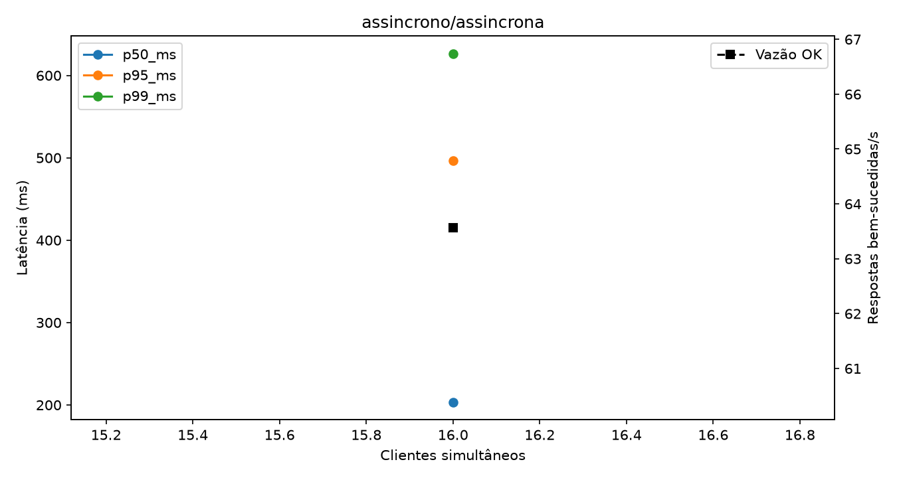

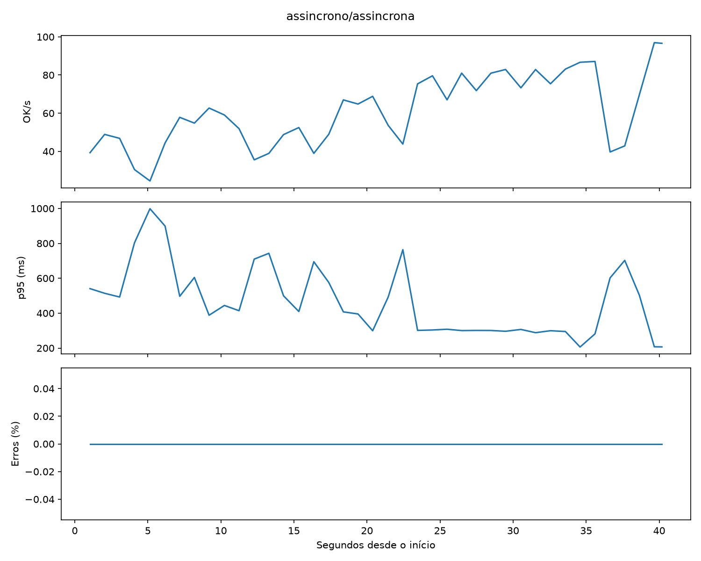

**Análise dos registros:** 2445 requisições, 0 falhas, 1 pods identificados. Distribuição por versão: `{'3.0.0': 2445}`. Respostas sem X-Pod podem ter sido geradas antes de atingir a API (por exemplo, no Ingress).
Pior duração registrada: 1000.59 ms; status 202; erro ``; início 2026-11-05T17:13:46.547+00:00.

| Marco observado | Hora UTC | Evidência |
|---|---|---|
| fim | 2026-11-05T17:14:32.960741+00:00 | {'leituras_depois': 76089, 'delta_persistido': 2445, 'aceites': 2445, 'erros_acoes': []} |
Compare os aceites com o delta persistido e o tempo de drenagem registrados no marco fim. A menor latência de aceite não equivale a maior capacidade sustentada do banco.

### assincrono/sincrona

**Hipótese:** A fila reduz o tempo do aceite, mas o SQLite ainda precisa concluir todas as escritas.

**Procedimento:** `G:\Meu Drive\PESSOAL\FACULDADE\8 semestre\APS\carga\loadgen.py http://127.0.0.1:8088/manancial/leituras -c 16 -d 40 --aquecimento 5 --timeout 5 --metodo POST --saida G:\Meu Drive\PESSOAL\FACULDADE\8 semestre\APS\resultados\execucao-20261105-completa\assincrono\sincrona\carga`

**Evidências:** [resumo](./assincrono/sincrona/carga-resumo.json), [requisições](./assincrono/sincrona/carga-requisicoes.csv), [série](./assincrono/sincrona/carga-segundos.csv), [eventos](./assincrono/sincrona/eventos.jsonl).

**Tabela:** linhas da execução na tabela geral acima.

**Gráficos:** 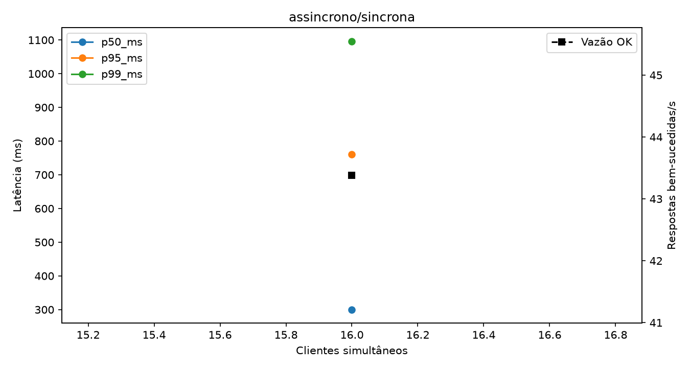

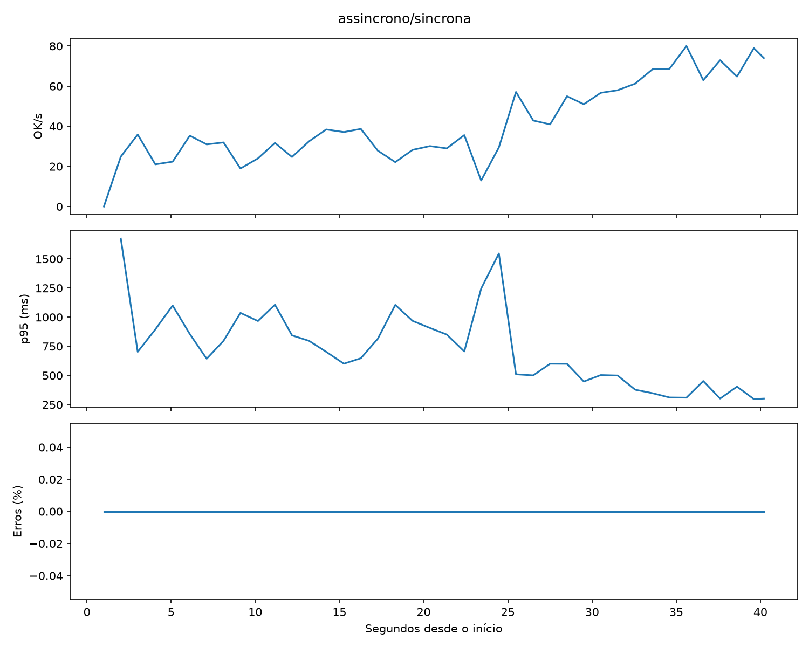

**Análise dos registros:** 1649 requisições, 0 falhas, 1 pods identificados. Distribuição por versão: `{'3.0.0': 1649}`. Respostas sem X-Pod podem ter sido geradas antes de atingir a API (por exemplo, no Ingress).
Pior duração registrada: 1701.39 ms; status 202; erro ``; início 2026-11-05T17:13:18.349+00:00.

| Marco observado | Hora UTC | Evidência |
|---|---|---|
| fim | 2026-11-05T17:13:36.462713+00:00 | {'leituras_depois': 73644, 'delta_persistido': 1649, 'aceites': 1649, 'erros_acoes': []} |
Compare os aceites com o delta persistido e o tempo de drenagem registrados no marco fim. A menor latência de aceite não equivale a maior capacidade sustentada do banco.

### base/get-1

**Hipótese:** A vazão cresce até um recurso saturar; depois a latência aumenta.

**Procedimento:** `G:\Meu Drive\PESSOAL\FACULDADE\8 semestre\APS\carga\loadgen.py http://127.0.0.1:8088/manancial/historico?limite=20&ordem=desc -c 16 -d 20 --aquecimento 5 --timeout 5 --metodo GET --saida G:\Meu Drive\PESSOAL\FACULDADE\8 semestre\APS\resultados\execucao-20261105-completa\base\get-1\carga --degraus 1,2,4,8,16,32,64`

**Evidências:** [resumo](./base/get-1/carga-resumo.json), [requisições](./base/get-1/carga-requisicoes.csv), [série](./base/get-1/carga-segundos.csv), [eventos](./base/get-1/eventos.jsonl).

**Tabela:** linhas da execução na tabela geral acima.

**Gráficos:** 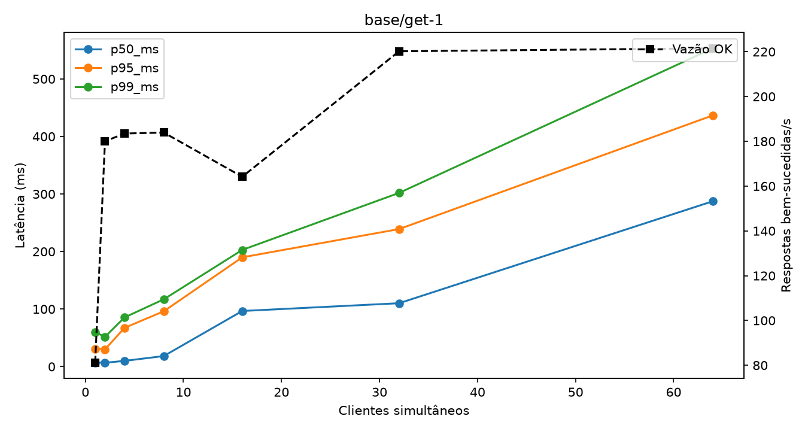

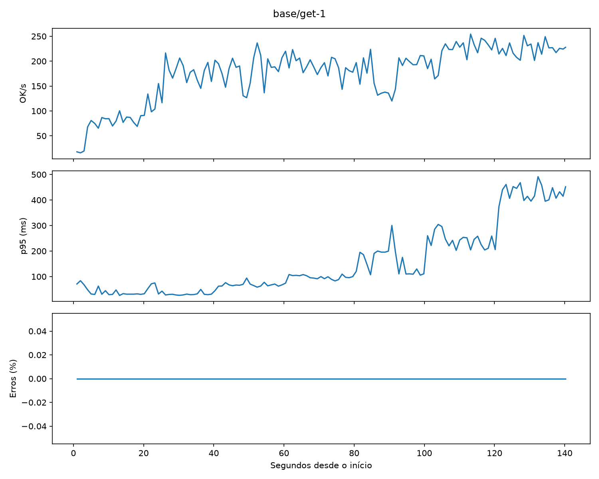

**Análise dos registros:** 24668 requisições, 0 falhas, 1 pods identificados. Distribuição por versão: `{'3.0.0': 24668}`. Respostas sem X-Pod podem ter sido geradas antes de atingir a API (por exemplo, no Ingress).
Pior duração registrada: 1397.89 ms; status 200; erro ``; início 2026-11-05T16:45:10.401+00:00.

| Marco observado | Hora UTC | Evidência |
|---|---|---|
| fim | 2026-11-05T16:45:20.131916+00:00 | {'leituras_depois': 29232, 'delta_persistido': 0, 'aceites': 24668, 'erros_acoes': []} |
Sinal de degradação pelo critério exploratório (erro ou p95 >1,5× com ganho de vazão <15%): [4, 16, 64]. Confrontar com CPU/fila e repetições antes de atribuir causa.

### base/get-2

**Hipótese:** A vazão cresce até um recurso saturar; depois a latência aumenta.

**Procedimento:** `G:\Meu Drive\PESSOAL\FACULDADE\8 semestre\APS\carga\loadgen.py http://127.0.0.1:8088/manancial/historico?limite=20&ordem=desc -c 16 -d 20 --aquecimento 5 --timeout 5 --metodo GET --saida G:\Meu Drive\PESSOAL\FACULDADE\8 semestre\APS\resultados\execucao-20261105-completa\base\get-2\carga --degraus 1,2,4,8,16,32,64`

**Evidências:** [resumo](./base/get-2/carga-resumo.json), [requisições](./base/get-2/carga-requisicoes.csv), [série](./base/get-2/carga-segundos.csv), [eventos](./base/get-2/eventos.jsonl).

**Tabela:** linhas da execução na tabela geral acima.

**Gráficos:** 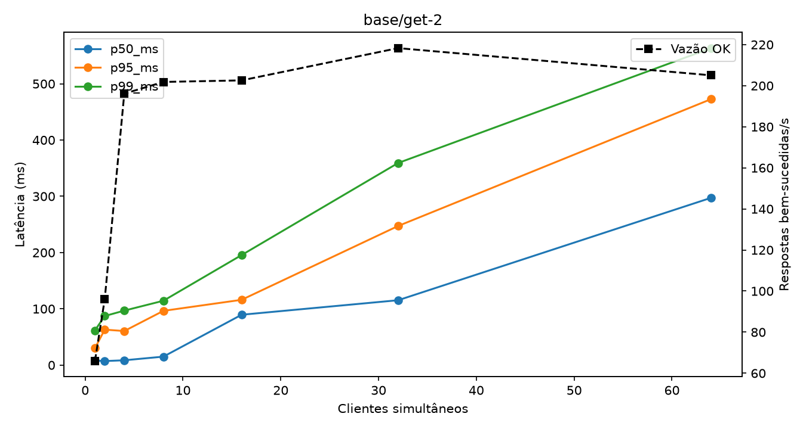

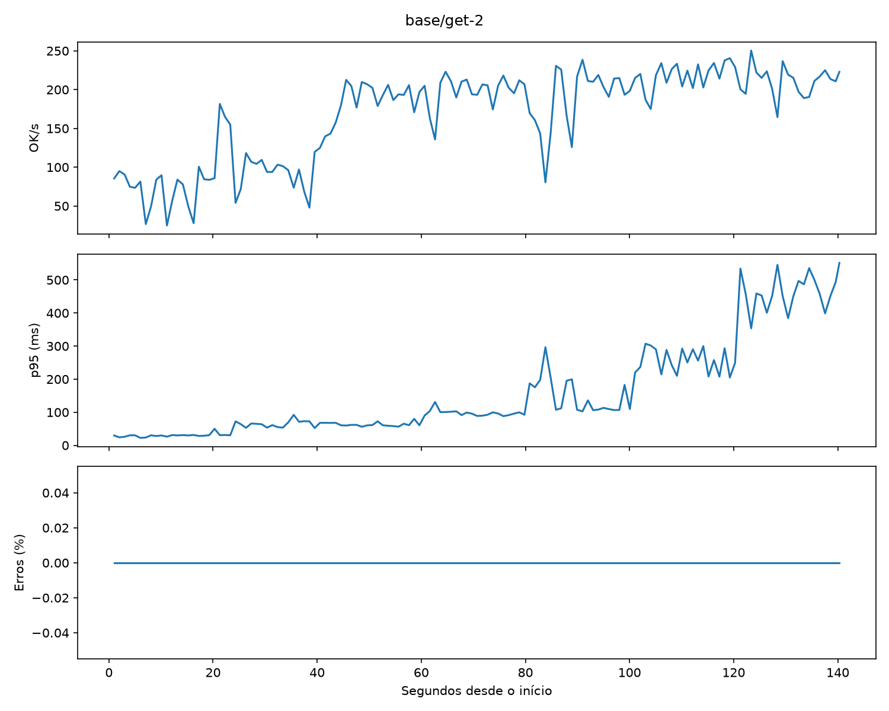

**Análise dos registros:** 23580 requisições, 0 falhas, 1 pods identificados. Distribuição por versão: `{'3.0.0': 23580}`. Respostas sem X-Pod podem ter sido geradas antes de atingir a API (por exemplo, no Ingress).
Pior duração registrada: 1400.27 ms; status 200; erro ``; início 2026-11-05T16:47:30.730+00:00.

| Marco observado | Hora UTC | Evidência |
|---|---|---|
| fim | 2026-11-05T16:47:42.012200+00:00 | {'leituras_depois': 29232, 'delta_persistido': 0, 'aceites': 23580, 'erros_acoes': []} |
Sinal de degradação pelo critério exploratório (erro ou p95 >1,5× com ganho de vazão <15%): [8, 32, 64]. Confrontar com CPU/fila e repetições antes de atribuir causa.

### base/get-3

**Hipótese:** A vazão cresce até um recurso saturar; depois a latência aumenta.

**Procedimento:** `G:\Meu Drive\PESSOAL\FACULDADE\8 semestre\APS\carga\loadgen.py http://127.0.0.1:8088/manancial/historico?limite=20&ordem=desc -c 16 -d 20 --aquecimento 5 --timeout 5 --metodo GET --saida G:\Meu Drive\PESSOAL\FACULDADE\8 semestre\APS\resultados\execucao-20261105-completa\base\get-3\carga --degraus 1,2,4,8,16,32,64`

**Evidências:** [resumo](./base/get-3/carga-resumo.json), [requisições](./base/get-3/carga-requisicoes.csv), [série](./base/get-3/carga-segundos.csv), [eventos](./base/get-3/eventos.jsonl).

**Tabela:** linhas da execução na tabela geral acima.

**Gráficos:** 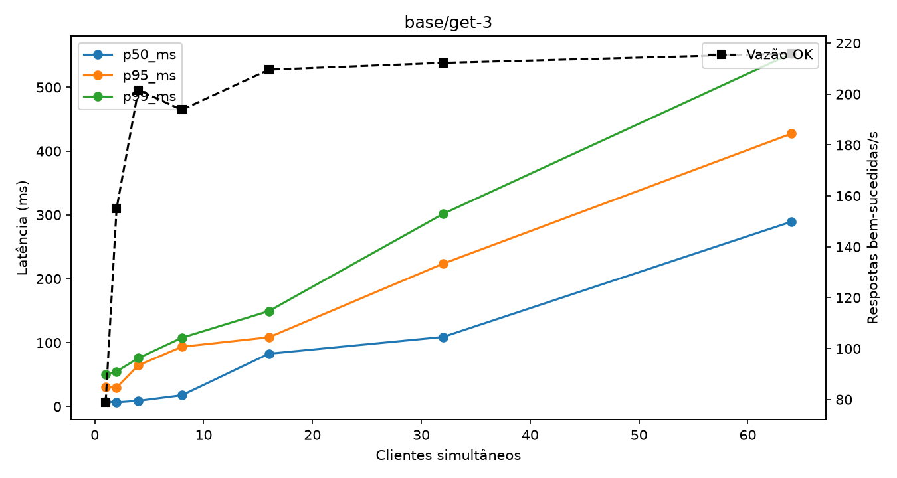

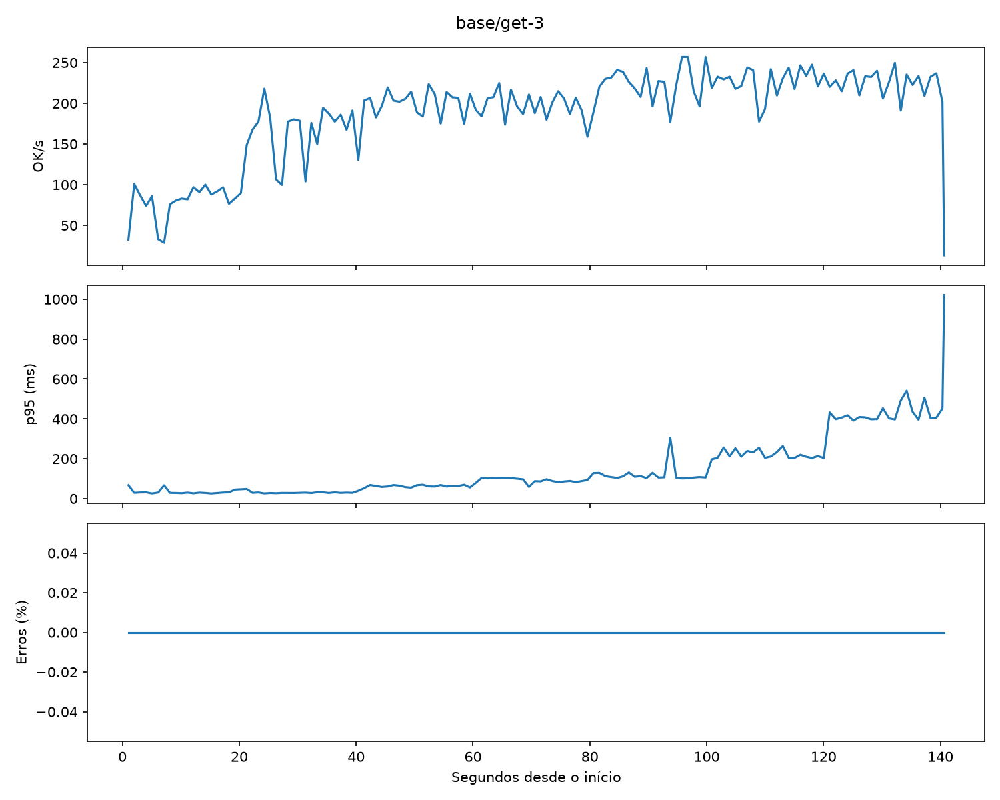

**Análise dos registros:** 26415 requisições, 0 falhas, 1 pods identificados. Distribuição por versão: `{'3.0.0': 26415}`. Respostas sem X-Pod podem ter sido geradas antes de atingir a API (por exemplo, no Ingress).
Pior duração registrada: 2107.14 ms; status 200; erro ``; início 2026-11-05T16:49:36.483+00:00.

| Marco observado | Hora UTC | Evidência |
|---|---|---|
| fim | 2026-11-05T16:50:04.354913+00:00 | {'leituras_depois': 29232, 'delta_persistido': 0, 'aceites': 26415, 'erros_acoes': []} |
Sinal de degradação pelo critério exploratório (erro ou p95 >1,5× com ganho de vazão <15%): [32, 64]. Confrontar com CPU/fila e repetições antes de atribuir causa.

### base/post-1

**Hipótese:** A vazão cresce até um recurso saturar; depois a latência aumenta.

**Procedimento:** `G:\Meu Drive\PESSOAL\FACULDADE\8 semestre\APS\carga\loadgen.py http://127.0.0.1:8088/manancial/leituras -c 16 -d 20 --aquecimento 5 --timeout 5 --metodo POST --saida G:\Meu Drive\PESSOAL\FACULDADE\8 semestre\APS\resultados\execucao-20261105-completa\base\post-1\carga --degraus 1,2,4,8,16,32,64`

**Evidências:** [resumo](./base/post-1/carga-resumo.json), [requisições](./base/post-1/carga-requisicoes.csv), [série](./base/post-1/carga-segundos.csv), [eventos](./base/post-1/eventos.jsonl).

**Tabela:** linhas da execução na tabela geral acima.

**Gráficos:** 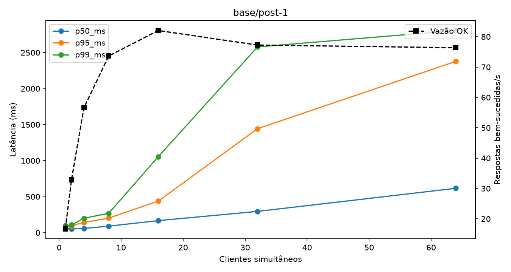

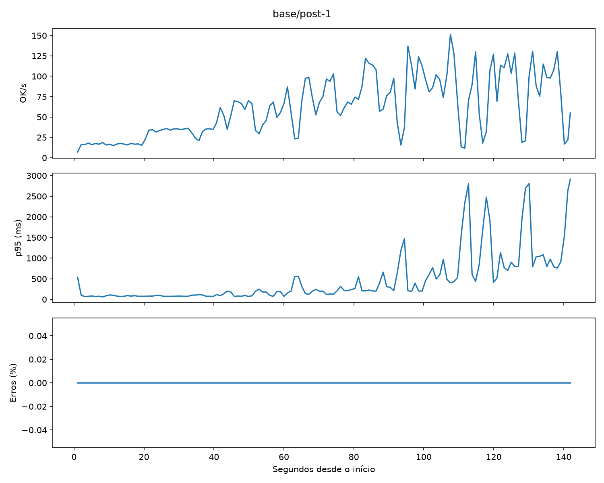

**Análise dos registros:** 8722 requisições, 0 falhas, 1 pods identificados. Distribuição por versão: `{'3.0.0': 8722}`. Respostas sem X-Pod podem ter sido geradas antes de atingir a API (por exemplo, no Ingress).
Pior duração registrada: 2998.73 ms; status 202; erro ``; início 2026-11-05T16:35:26.984+00:00.

| Marco observado | Hora UTC | Evidência |
|---|---|---|
| fim | 2026-11-05T16:36:28.300475+00:00 | {'leituras_depois': 8725, 'delta_persistido': 8722, 'aceites': 8722, 'erros_acoes': []} |
Sinal de degradação pelo critério exploratório (erro ou p95 >1,5× com ganho de vazão <15%): [16, 32, 64]. Confrontar com CPU/fila e repetições antes de atribuir causa.

### base/post-2

**Hipótese:** A vazão cresce até um recurso saturar; depois a latência aumenta.

**Procedimento:** `G:\Meu Drive\PESSOAL\FACULDADE\8 semestre\APS\carga\loadgen.py http://127.0.0.1:8088/manancial/leituras -c 16 -d 20 --aquecimento 5 --timeout 5 --metodo POST --saida G:\Meu Drive\PESSOAL\FACULDADE\8 semestre\APS\resultados\execucao-20261105-completa\base\post-2\carga --degraus 1,2,4,8,16,32,64`

**Evidências:** [resumo](./base/post-2/carga-resumo.json), [requisições](./base/post-2/carga-requisicoes.csv), [série](./base/post-2/carga-segundos.csv), [eventos](./base/post-2/eventos.jsonl).

**Tabela:** linhas da execução na tabela geral acima.

**Gráficos:** 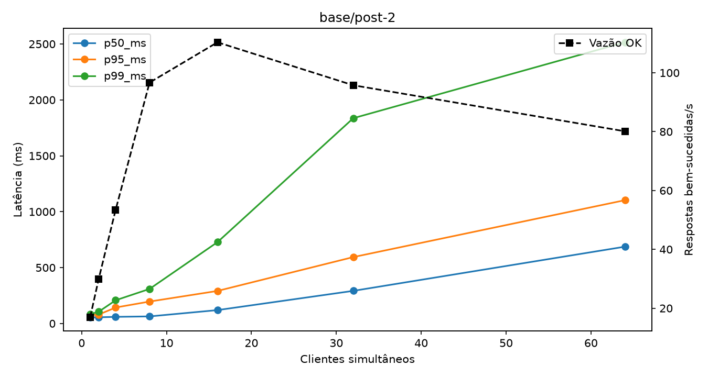

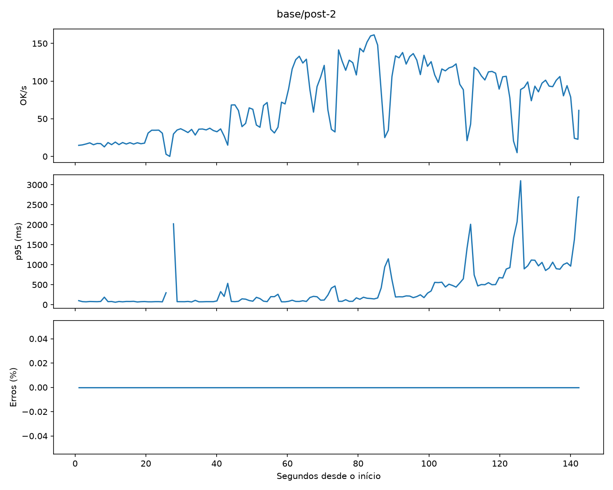

**Análise dos registros:** 10272 requisições, 0 falhas, 1 pods identificados. Distribuição por versão: `{'3.0.0': 10272}`. Respostas sem X-Pod podem ter sido geradas antes de atingir a API (por exemplo, no Ingress).
Pior duração registrada: 3159.24 ms; status 202; erro ``; início 2026-11-05T16:38:34.007+00:00.

| Marco observado | Hora UTC | Evidência |
|---|---|---|
| fim | 2026-11-05T16:39:47.503962+00:00 | {'leituras_depois': 18997, 'delta_persistido': 10272, 'aceites': 10272, 'erros_acoes': []} |
Sinal de degradação pelo critério exploratório (erro ou p95 >1,5× com ganho de vazão <15%): [32, 64]. Confrontar com CPU/fila e repetições antes de atribuir causa.

### base/post-3

**Hipótese:** A vazão cresce até um recurso saturar; depois a latência aumenta.

**Procedimento:** `G:\Meu Drive\PESSOAL\FACULDADE\8 semestre\APS\carga\loadgen.py http://127.0.0.1:8088/manancial/leituras -c 16 -d 20 --aquecimento 5 --timeout 5 --metodo POST --saida G:\Meu Drive\PESSOAL\FACULDADE\8 semestre\APS\resultados\execucao-20261105-completa\base\post-3\carga --degraus 1,2,4,8,16,32,64`

**Evidências:** [resumo](./base/post-3/carga-resumo.json), [requisições](./base/post-3/carga-requisicoes.csv), [série](./base/post-3/carga-segundos.csv), [eventos](./base/post-3/eventos.jsonl).

**Tabela:** linhas da execução na tabela geral acima.

**Gráficos:** 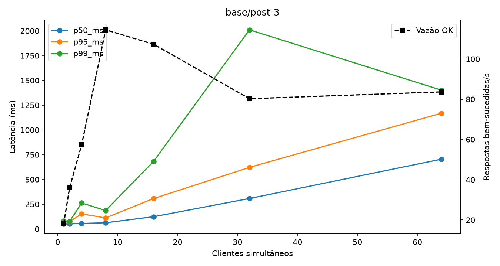

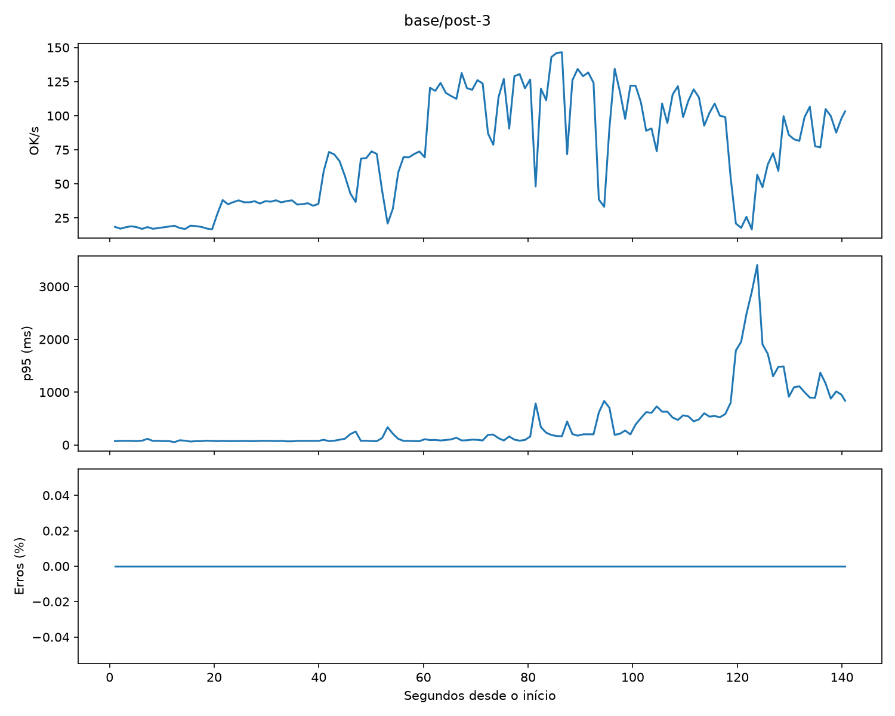

**Análise dos registros:** 10235 requisições, 0 falhas, 1 pods identificados. Distribuição por versão: `{'3.0.0': 10235}`. Respostas sem X-Pod podem ter sido geradas antes de atingir a API (por exemplo, no Ingress).
Pior duração registrada: 3482.97 ms; status 202; erro ``; início 2026-11-05T16:41:48.671+00:00.

| Marco observado | Hora UTC | Evidência |
|---|---|---|
| fim | 2026-11-05T16:42:58.512314+00:00 | {'leituras_depois': 29232, 'delta_persistido': 10235, 'aceites': 10235, 'erros_acoes': []} |
Sinal de degradação pelo critério exploratório (erro ou p95 >1,5× com ganho de vazão <15%): [16, 32, 64]. Confrontar com CPU/fila e repetições antes de atribuir causa.

### falhas/no

**Hipótese:** As réplicas sobreviventes atendem enquanto o controlador repõe a capacidade.

**Procedimento:** `G:\Meu Drive\PESSOAL\FACULDADE\8 semestre\APS\carga\loadgen.py http://127.0.0.1:8088/manancial/leituras -c 24 -d 100 --aquecimento 5 --timeout 5 --metodo POST --saida G:\Meu Drive\PESSOAL\FACULDADE\8 semestre\APS\resultados\execucao-20261105-completa\falhas\no\carga`

**Evidências:** [resumo](./falhas/no/carga-resumo.json), [requisições](./falhas/no/carga-requisicoes.csv), [série](./falhas/no/carga-segundos.csv), [eventos](./falhas/no/eventos.jsonl).

**Tabela:** linhas da execução na tabela geral acima.

**Gráficos:** 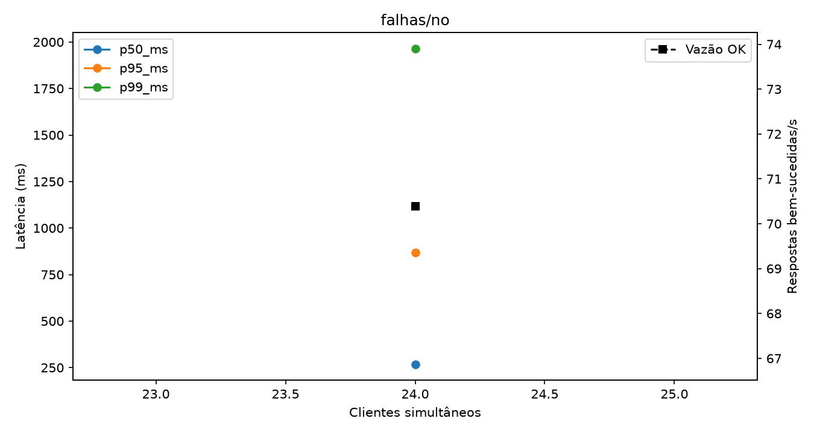

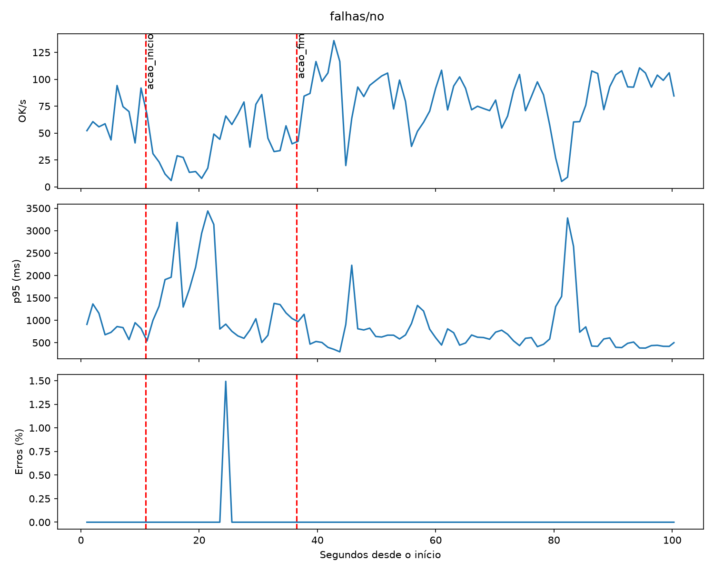

**Análise dos registros:** 7007 requisições, 1 falhas, 6 pods identificados. Distribuição por versão: `{'3.0.0': 7006, '': 1}`. Respostas sem X-Pod podem ter sido geradas antes de atingir a API (por exemplo, no Ingress).
Pior duração registrada: 3439.24 ms; status 202; erro ``; início 2026-11-05T17:04:08.386+00:00.

| Marco observado | Hora UTC | Evidência |
|---|---|---|
| acao_inicio | 2026-11-05T17:04:02.073807+00:00 | {} |
| acao_fim | 2026-11-05T17:04:27.597585+00:00 | {'resultado': 'node/aps-experimentos-worker cordoned\nevicting pod aps-lab/manancial-7c5dc897d-95s4q\nevicting pod aps-lab/inversao-termica-5f6586b599-lg2z6\nevicting pod aps-lab/manancial-7c5dc897d-7zdcc\nevicting pod aps-lab/alagamento-8555cd7897-wqlc8\npod/alagamento-8555cd7897-wqlc8 evicted\npod/manancial-7c5dc897d-7zdcc evicted\npod/inversao-termica-5f6586b599-lg2z6 evicted\npod/manancial-7c5dc897d-95s4q evicted\nnode/aps-experimentos-worker drained\nWarning: ignoring DaemonSet-managed Pods: kube-system/kindnet-bwxl4, kube-system/kube-proxy-kcg9j\n'} |
| fim | 2026-11-05T17:06:13.601389+00:00 | {'leituras_depois': 61119, 'delta_persistido': 7006, 'aceites': 7006, 'erros_acoes': []} |
O tempo da ação administrativa não é o tempo de recuperação do cliente. Use a série após acao_inicio para localizar erros e retorno do p95. A falha exercitada é no atendimento; não remove o coordenador persistente.

### falhas/pod

**Hipótese:** As réplicas sobreviventes atendem enquanto o controlador repõe a capacidade.

**Procedimento:** `G:\Meu Drive\PESSOAL\FACULDADE\8 semestre\APS\carga\loadgen.py http://127.0.0.1:8088/manancial/leituras -c 24 -d 60 --aquecimento 5 --timeout 5 --metodo POST --saida G:\Meu Drive\PESSOAL\FACULDADE\8 semestre\APS\resultados\execucao-20261105-completa\falhas\pod\carga`

**Evidências:** [resumo](./falhas/pod/carga-resumo.json), [requisições](./falhas/pod/carga-requisicoes.csv), [série](./falhas/pod/carga-segundos.csv), [eventos](./falhas/pod/eventos.jsonl).

**Tabela:** linhas da execução na tabela geral acima.

**Gráficos:** 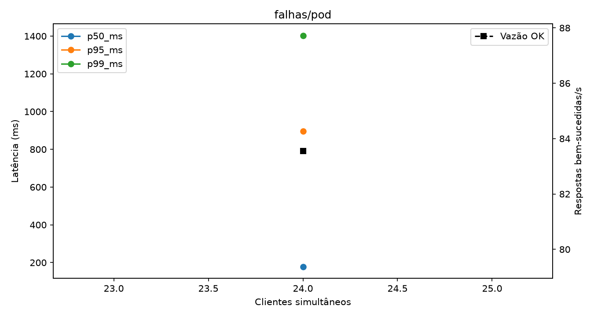

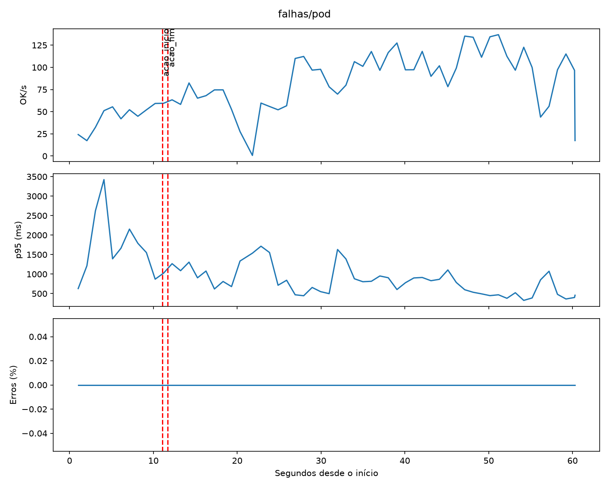

**Análise dos registros:** 4825 requisições, 0 falhas, 5 pods identificados. Distribuição por versão: `{'3.0.0': 4825}`. Respostas sem X-Pod podem ter sido geradas antes de atingir a API (por exemplo, no Ingress).
Pior duração registrada: 4018.85 ms; status 202; erro ``; início 2026-11-05T17:02:04.306+00:00.

| Marco observado | Hora UTC | Evidência |
|---|---|---|
| acao_inicio | 2026-11-05T17:02:15.355419+00:00 | {} |
| acao_fim | 2026-11-05T17:02:16.021343+00:00 | {'resultado': 'pod "manancial-7c5dc897d-6pgrh" deleted from aps-lab namespace\n'} |
| fim | 2026-11-05T17:03:34.489979+00:00 | {'leituras_depois': 54113, 'delta_persistido': 4825, 'aceites': 4825, 'erros_acoes': []} |
O tempo da ação administrativa não é o tempo de recuperação do cliente. Use a série após acao_inicio para localizar erros e retorno do p95. A falha exercitada é no atendimento; não remove o coordenador persistente.

### hpa/rampa

**Hipótese:** A CPU induz criação de réplicas, com atraso até prontidão e normalização da latência.

**Procedimento:** `G:\Meu Drive\PESSOAL\FACULDADE\8 semestre\APS\carga\loadgen.py http://127.0.0.1:8088/manancial/leituras -c 64 -d 180 --aquecimento 5 --timeout 5 --metodo POST --saida G:\Meu Drive\PESSOAL\FACULDADE\8 semestre\APS\resultados\execucao-20261105-completa\hpa\rampa\carga --rampa 120`

**Evidências:** [resumo](./hpa/rampa/carga-resumo.json), [requisições](./hpa/rampa/carga-requisicoes.csv), [série](./hpa/rampa/carga-segundos.csv), [eventos](./hpa/rampa/eventos.jsonl).

**Tabela:** linhas da execução na tabela geral acima.

**Gráficos:** 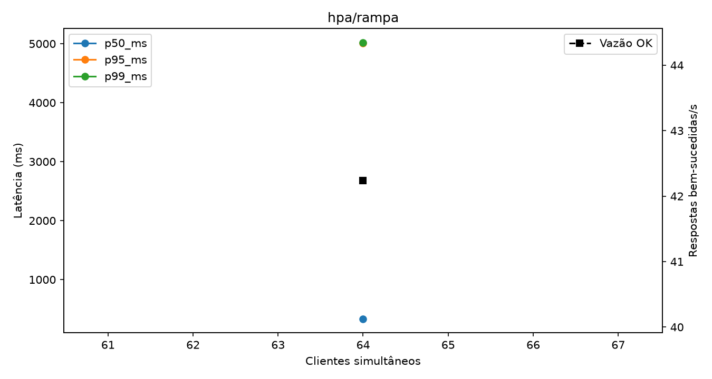

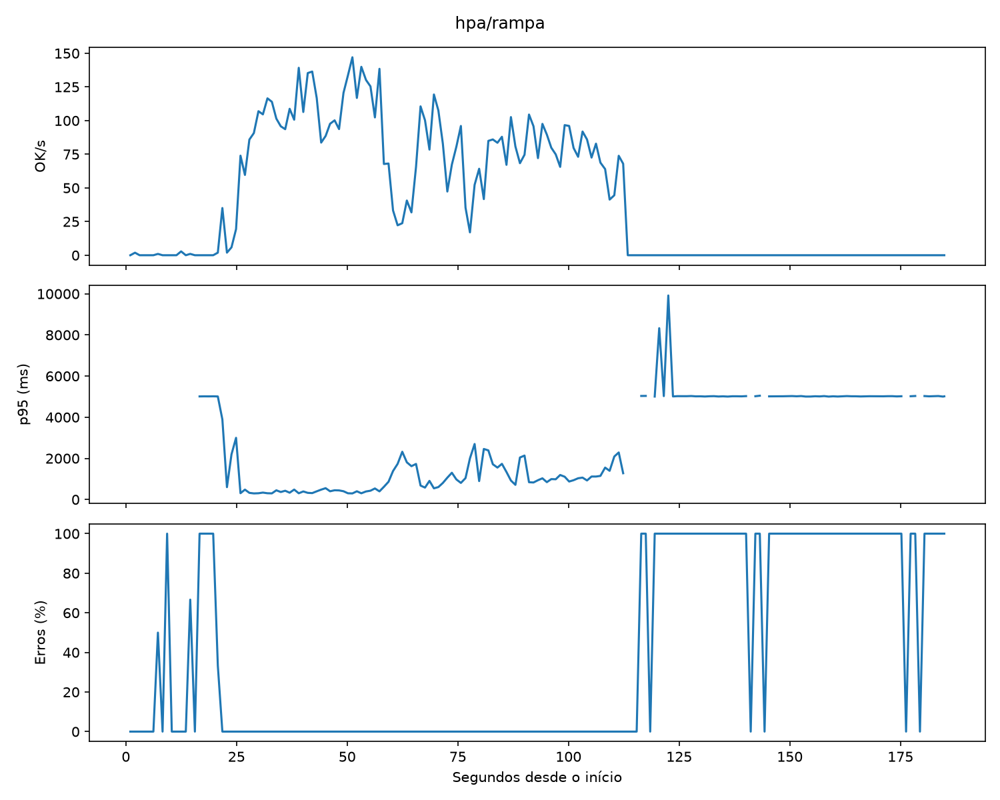

**Análise dos registros:** 8488 requisições, 889 falhas, 7 pods identificados. Distribuição por versão: `{'3.0.0': 7599, '': 889}`. Respostas sem X-Pod podem ter sido geradas antes de atingir a API (por exemplo, no Ingress).
Pior duração registrada: 10024.15 ms; status 0; erro `timeout`; início 2026-11-05T16:56:10.618+00:00.

| Marco observado | Hora UTC | Evidência |
|---|---|---|
Os snapshots em eventos.jsonl contêm as decisões SuccessfulRescale, condições Ready e CPU. A série mede o atraso percebido. Normalização de p95 só pode ser afirmada se ele regressar ao patamar de referência; criar pods por si só não comprova recuperação de latência.

### manual/1-replicas

**Hipótese:** Mais atendimentos ajudam somente se a coordenação, o banco e a máquina tiverem folga.

**Procedimento:** `G:\Meu Drive\PESSOAL\FACULDADE\8 semestre\APS\carga\loadgen.py http://127.0.0.1:8088/manancial/leituras -c 32 -d 35 --aquecimento 5 --timeout 5 --metodo POST --saida G:\Meu Drive\PESSOAL\FACULDADE\8 semestre\APS\resultados\execucao-20261105-completa\manual\1-replicas\carga`

**Evidências:** [resumo](./manual/1-replicas/carga-resumo.json), [requisições](./manual/1-replicas/carga-requisicoes.csv), [série](./manual/1-replicas/carga-segundos.csv), [eventos](./manual/1-replicas/eventos.jsonl).

**Tabela:** linhas da execução na tabela geral acima.

**Gráficos:** 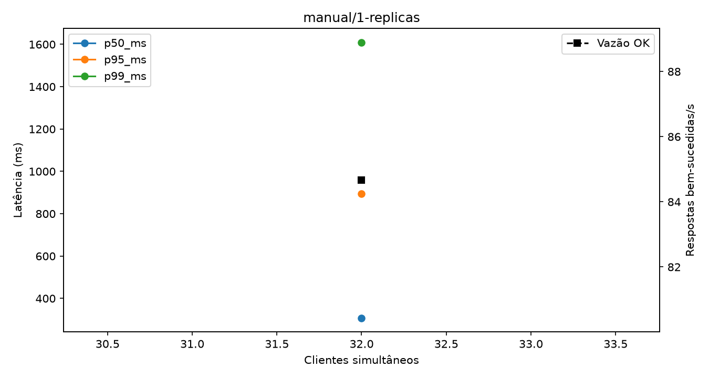

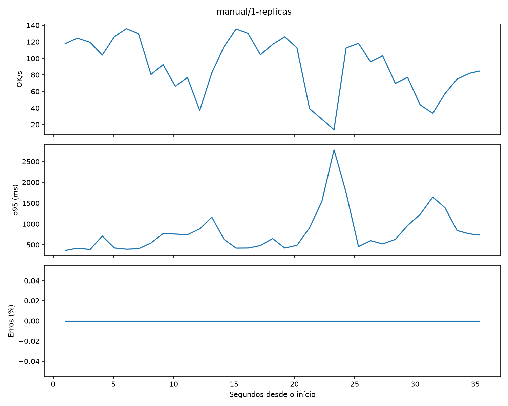

**Análise dos registros:** 3192 requisições, 0 falhas, 1 pods identificados. Distribuição por versão: `{'3.0.0': 3192}`. Respostas sem X-Pod podem ter sido geradas antes de atingir a API (por exemplo, no Ingress).
Pior duração registrada: 2785.56 ms; status 202; erro ``; início 2026-11-05T16:50:26.803+00:00.

| Marco observado | Hora UTC | Evidência |
|---|---|---|
| fim | 2026-11-05T16:51:03.254227+00:00 | {'leituras_depois': 32424, 'delta_persistido': 3192, 'aceites': 3192, 'erros_acoes': []} |
A coordenação permanece única. Um ganho pequeno ou negativo refuta escala linear nesta arquitetura; o número de réplicas HTTP não remove as escritas serializadas nem o compartilhamento físico da CPU.

### manual/2-replicas

**Hipótese:** Mais atendimentos ajudam somente se a coordenação, o banco e a máquina tiverem folga.

**Procedimento:** `G:\Meu Drive\PESSOAL\FACULDADE\8 semestre\APS\carga\loadgen.py http://127.0.0.1:8088/manancial/leituras -c 32 -d 35 --aquecimento 5 --timeout 5 --metodo POST --saida G:\Meu Drive\PESSOAL\FACULDADE\8 semestre\APS\resultados\execucao-20261105-completa\manual\2-replicas\carga`

**Evidências:** [resumo](./manual/2-replicas/carga-resumo.json), [requisições](./manual/2-replicas/carga-requisicoes.csv), [série](./manual/2-replicas/carga-segundos.csv), [eventos](./manual/2-replicas/eventos.jsonl).

**Tabela:** linhas da execução na tabela geral acima.

**Gráficos:** 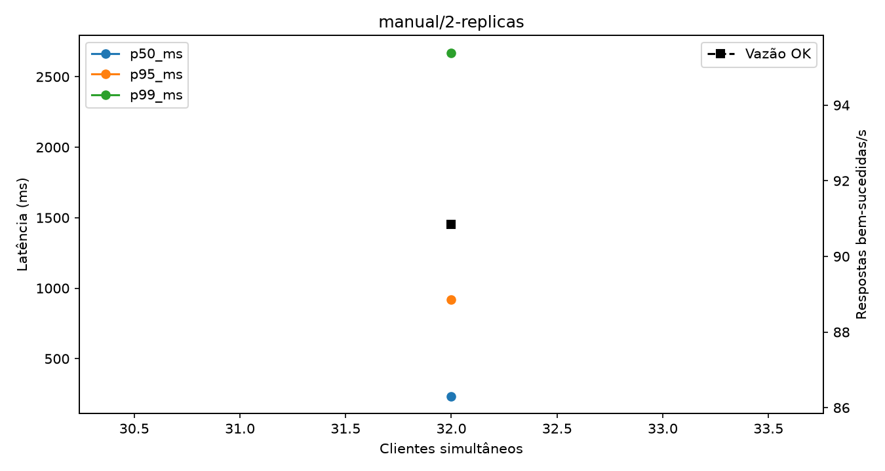

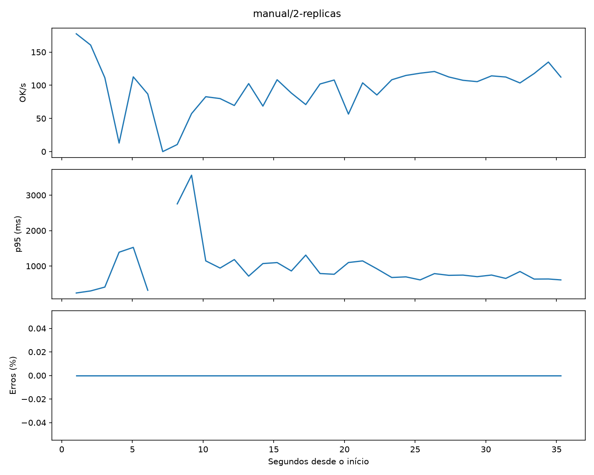

**Análise dos registros:** 3361 requisições, 0 falhas, 2 pods identificados. Distribuição por versão: `{'3.0.0': 3361}`. Respostas sem X-Pod podem ter sido geradas antes de atingir a API (por exemplo, no Ingress).
Pior duração registrada: 3579.37 ms; status 202; erro ``; início 2026-11-05T16:51:17.541+00:00.

| Marco observado | Hora UTC | Evidência |
|---|---|---|
| fim | 2026-11-05T16:52:02.981204+00:00 | {'leituras_depois': 35785, 'delta_persistido': 3361, 'aceites': 3361, 'erros_acoes': []} |
A coordenação permanece única. Um ganho pequeno ou negativo refuta escala linear nesta arquitetura; o número de réplicas HTTP não remove as escritas serializadas nem o compartilhamento físico da CPU.

### manual/4-replicas

**Hipótese:** Mais atendimentos ajudam somente se a coordenação, o banco e a máquina tiverem folga.

**Procedimento:** `G:\Meu Drive\PESSOAL\FACULDADE\8 semestre\APS\carga\loadgen.py http://127.0.0.1:8088/manancial/leituras -c 32 -d 35 --aquecimento 5 --timeout 5 --metodo POST --saida G:\Meu Drive\PESSOAL\FACULDADE\8 semestre\APS\resultados\execucao-20261105-completa\manual\4-replicas\carga`

**Evidências:** [resumo](./manual/4-replicas/carga-resumo.json), [requisições](./manual/4-replicas/carga-requisicoes.csv), [série](./manual/4-replicas/carga-segundos.csv), [eventos](./manual/4-replicas/eventos.jsonl).

**Tabela:** linhas da execução na tabela geral acima.

**Gráficos:** 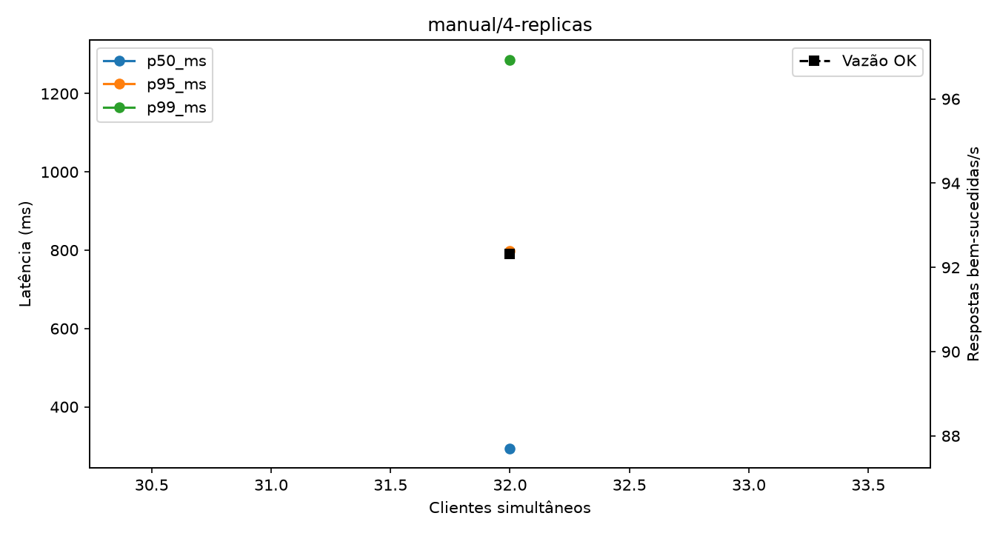

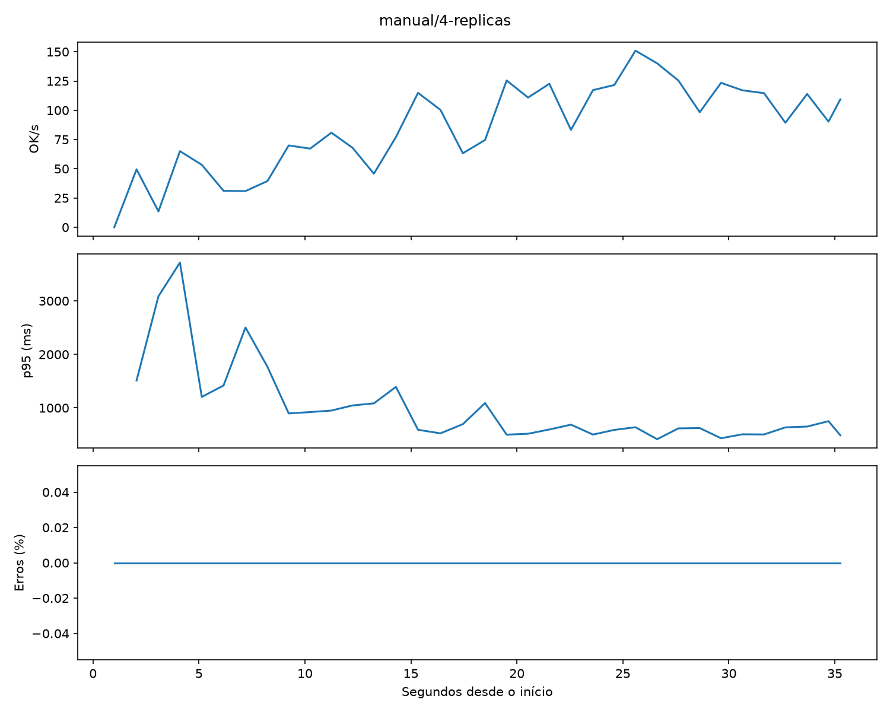

**Análise dos registros:** 3005 requisições, 0 falhas, 4 pods identificados. Distribuição por versão: `{'3.0.0': 3005}`. Respostas sem X-Pod podem ter sido geradas antes de atingir a API (por exemplo, no Ingress).
Pior duração registrada: 4013.03 ms; status 202; erro ``; início 2026-11-05T16:52:13.818+00:00.

| Marco observado | Hora UTC | Evidência |
|---|---|---|
| fim | 2026-11-05T16:53:07.770789+00:00 | {'leituras_depois': 38790, 'delta_persistido': 3005, 'aceites': 3005, 'erros_acoes': []} |
A coordenação permanece única. Um ganho pequeno ou negativo refuta escala linear nesta arquitetura; o número de réplicas HTTP não remove as escritas serializadas nem o compartilhamento físico da CPU.

### manual/8-replicas

**Hipótese:** Mais atendimentos ajudam somente se a coordenação, o banco e a máquina tiverem folga.

**Procedimento:** `G:\Meu Drive\PESSOAL\FACULDADE\8 semestre\APS\carga\loadgen.py http://127.0.0.1:8088/manancial/leituras -c 32 -d 35 --aquecimento 5 --timeout 5 --metodo POST --saida G:\Meu Drive\PESSOAL\FACULDADE\8 semestre\APS\resultados\execucao-20261105-completa\manual\8-replicas\carga`

**Evidências:** [resumo](./manual/8-replicas/carga-resumo.json), [requisições](./manual/8-replicas/carga-requisicoes.csv), [série](./manual/8-replicas/carga-segundos.csv), [eventos](./manual/8-replicas/eventos.jsonl).

**Tabela:** linhas da execução na tabela geral acima.

**Gráficos:** 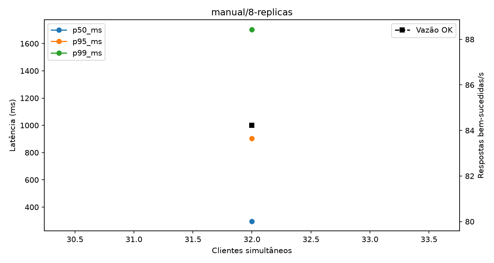

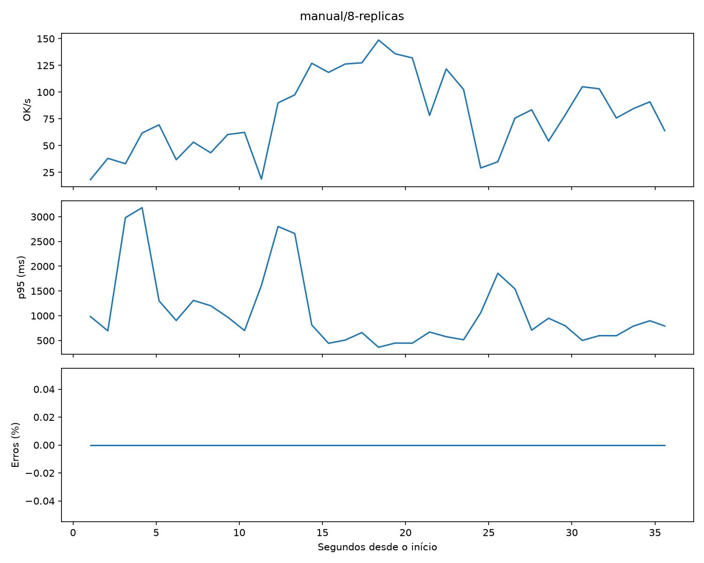

**Análise dos registros:** 2819 requisições, 0 falhas, 8 pods identificados. Distribuição por versão: `{'3.0.0': 2819}`. Respostas sem X-Pod podem ter sido geradas antes de atingir a API (por exemplo, no Ingress).
Pior duração registrada: 3583.87 ms; status 202; erro ``; início 2026-11-05T16:53:17.563+00:00.

| Marco observado | Hora UTC | Evidência |
|---|---|---|
| fim | 2026-11-05T16:54:10.400390+00:00 | {'leituras_depois': 41609, 'delta_persistido': 2819, 'aceites': 2819, 'erros_acoes': []} |
A coordenação permanece única. Um ganho pequeno ou negativo refuta escala linear nesta arquitetura; o número de réplicas HTTP não remove as escritas serializadas nem o compartilhamento físico da CPU.

### update/rolling

**Hipótese:** Readiness e preStop reduzem interrupções; versões coexistem durante a troca.

**Procedimento:** `G:\Meu Drive\PESSOAL\FACULDADE\8 semestre\APS\carga\loadgen.py http://127.0.0.1:8088/manancial/leituras -c 24 -d 70 --aquecimento 5 --timeout 5 --metodo POST --saida G:\Meu Drive\PESSOAL\FACULDADE\8 semestre\APS\resultados\execucao-20261105-completa\update\rolling\carga`

**Evidências:** [resumo](./update/rolling/carga-resumo.json), [requisições](./update/rolling/carga-requisicoes.csv), [série](./update/rolling/carga-segundos.csv), [eventos](./update/rolling/eventos.jsonl).

**Tabela:** linhas da execução na tabela geral acima.

**Gráficos:** 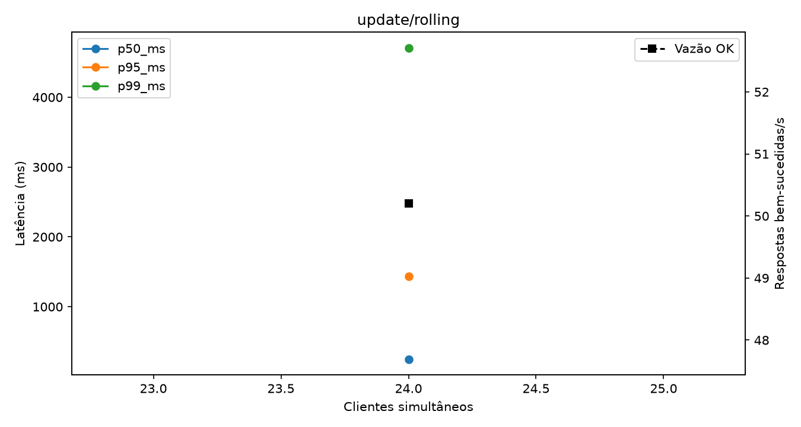

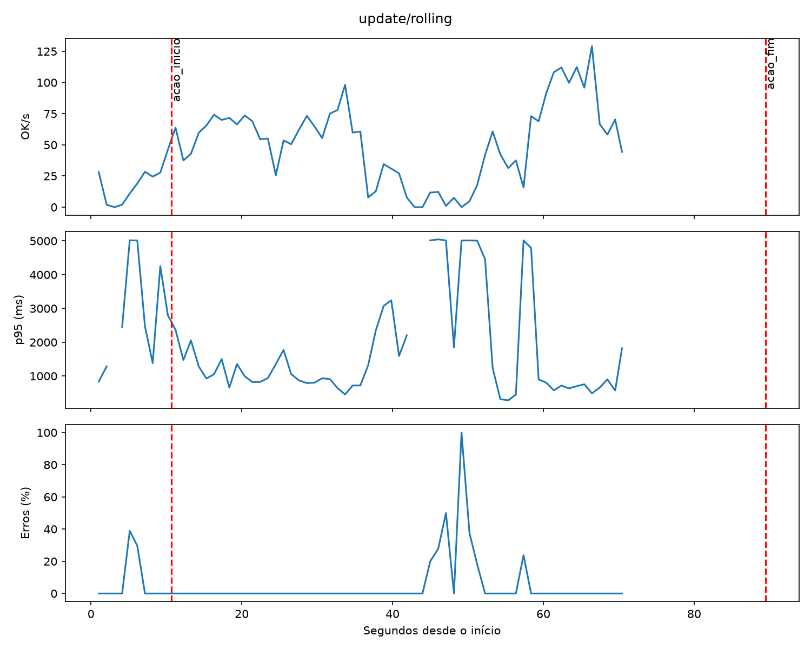

**Análise dos registros:** 3374 requisições, 37 falhas, 6 pods identificados. Distribuição por versão: `{'3.0.0': 3006, '': 37, '3.0.1': 331}`. Respostas sem X-Pod podem ter sido geradas antes de atingir a API (por exemplo, no Ingress).
Pior duração registrada: 5101.23 ms; status 202; erro ``; início 2026-11-05T17:07:32.385+00:00.

| Marco observado | Hora UTC | Evidência |
|---|---|---|
| acao_inicio | 2026-11-05T17:06:50.655908+00:00 | {} |
| acao_fim | 2026-11-05T17:08:09.469721+00:00 | {'resultado': 'deployment.apps/manancial patched\nWaiting for deployment spec update to be observed...\nWaiting for deployment "manancial" rollout to finish: 0 out of 4 new replicas have been updated...\nWaiting for deployment "manancial" rollout to finish: 1 out of 4 new replicas have been updated...\nWaiting for deployment "manancial" rollout to finish: 1 out of 4 new replicas have been updated...\nWaiting for deployment "manancial" rollout to finish: 1 out of 4 new replicas have been updated...\nWaiting for deployment "manancial" rollout to finish: 1 out of 4 new replicas have been updated. |
| fim | 2026-11-05T17:08:13.237927+00:00 | {'leituras_depois': 64493, 'delta_persistido': 3374, 'aceites': 3337, 'erros_acoes': []} |
| divergencia_persistencia | 2026-11-05T17:08:13.244085+00:00 | {'nota': 'Timeout pode ter sido aceito; correlacionar evento_id e logs.'} |
Versões observadas: 3.0.0, 3.0.1. A execução observou mais de uma versão. Compare falhas e p95 entre rolling, undo e sem-prestop, sem presumir zero interrupções.

### update/sem-prestop

**Hipótese:** Readiness e preStop reduzem interrupções; versões coexistem durante a troca.

**Procedimento:** `G:\Meu Drive\PESSOAL\FACULDADE\8 semestre\APS\carga\loadgen.py http://127.0.0.1:8088/manancial/leituras -c 24 -d 70 --aquecimento 5 --timeout 5 --metodo POST --saida G:\Meu Drive\PESSOAL\FACULDADE\8 semestre\APS\resultados\execucao-20261105-completa\update\sem-prestop\carga`

**Evidências:** [resumo](./update/sem-prestop/carga-resumo.json), [requisições](./update/sem-prestop/carga-requisicoes.csv), [série](./update/sem-prestop/carga-segundos.csv), [eventos](./update/sem-prestop/eventos.jsonl).

**Tabela:** linhas da execução na tabela geral acima.

**Gráficos:** 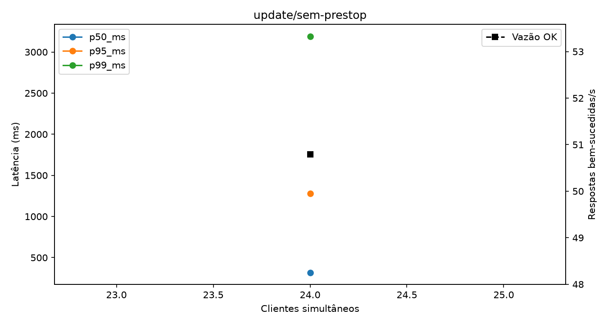

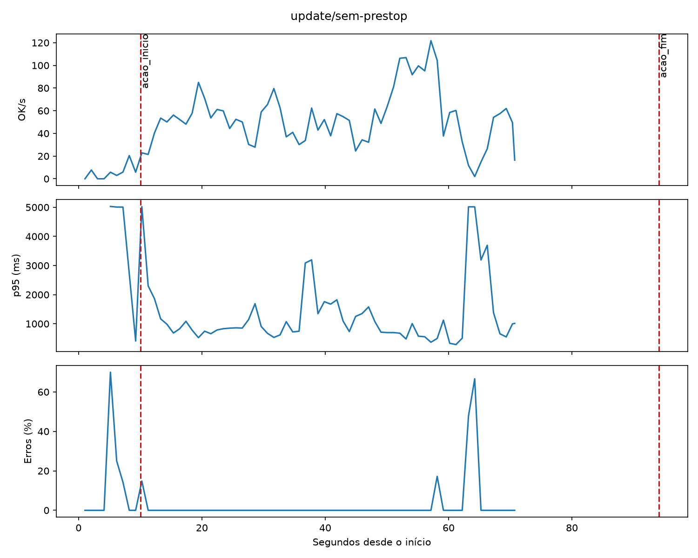

**Análise dos registros:** 3413 requisições, 57 falhas, 7 pods identificados. Distribuição por versão: `{'3.0.0': 2718, '': 57, '3.0.1': 638}`. Respostas sem X-Pod podem ter sido geradas antes de atingir a API (por exemplo, no Ingress).
Pior duração registrada: 5046.49 ms; status 202; erro ``; início 2026-11-05T17:10:34.901+00:00.

| Marco observado | Hora UTC | Evidência |
|---|---|---|
| acao_inicio | 2026-11-05T17:10:44.958386+00:00 | {} |
| acao_fim | 2026-11-05T17:12:08.985905+00:00 | {'resultado': 'deployment.apps/manancial patched\nWaiting for deployment "manancial" rollout to finish: 0 out of 4 new replicas have been updated...\nWaiting for deployment "manancial" rollout to finish: 1 out of 4 new replicas have been updated...\nWaiting for deployment "manancial" rollout to finish: 1 out of 4 new replicas have been updated...\nWaiting for deployment "manancial" rollout to finish: 1 out of 4 new replicas have been updated...\nWaiting for deployment "manancial" rollout to finish: 1 out of 4 new replicas have been updated...\nWaiting for deployment "manancial" rollout to fini |
| fim | 2026-11-05T17:12:15.487213+00:00 | {'leituras_depois': 71995, 'delta_persistido': 3376, 'aceites': 3356, 'erros_acoes': []} |
| divergencia_persistencia | 2026-11-05T17:12:15.492577+00:00 | {'nota': 'Timeout pode ter sido aceito; correlacionar evento_id e logs.'} |
Versões observadas: 3.0.0, 3.0.1. A execução observou mais de uma versão. Compare falhas e p95 entre rolling, undo e sem-prestop, sem presumir zero interrupções.

### update/undo

**Hipótese:** Readiness e preStop reduzem interrupções; versões coexistem durante a troca.

**Procedimento:** `G:\Meu Drive\PESSOAL\FACULDADE\8 semestre\APS\carga\loadgen.py http://127.0.0.1:8088/manancial/leituras -c 24 -d 70 --aquecimento 5 --timeout 5 --metodo POST --saida G:\Meu Drive\PESSOAL\FACULDADE\8 semestre\APS\resultados\execucao-20261105-completa\update\undo\carga`

**Evidências:** [resumo](./update/undo/carga-resumo.json), [requisições](./update/undo/carga-requisicoes.csv), [série](./update/undo/carga-segundos.csv), [eventos](./update/undo/eventos.jsonl).

**Tabela:** linhas da execução na tabela geral acima.

**Gráficos:** 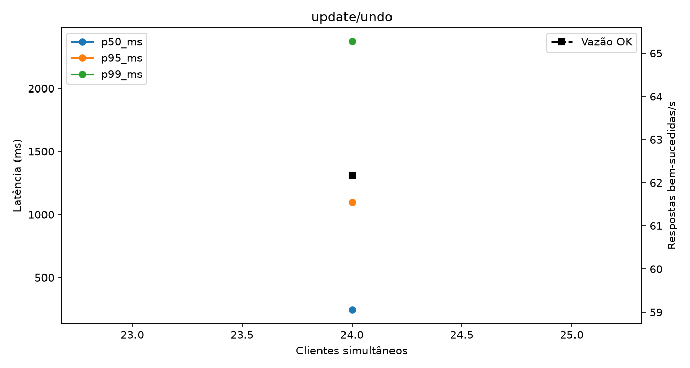

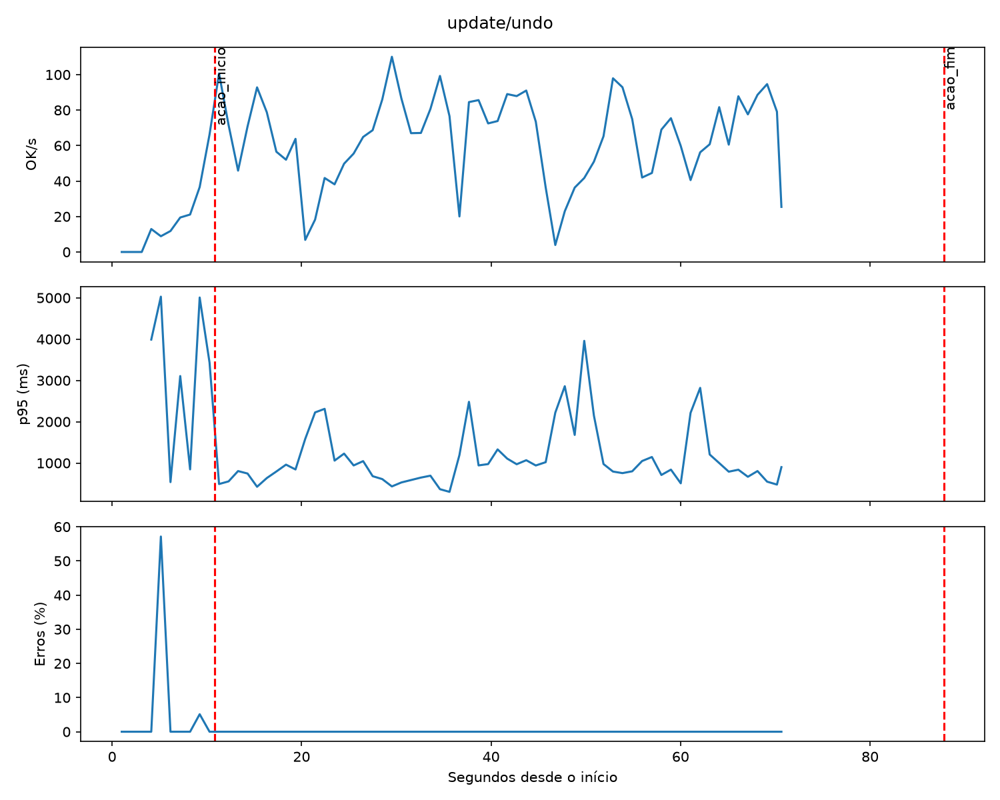

**Análise dos registros:** 4126 requisições, 14 falhas, 6 pods identificados. Distribuição por versão: `{'3.0.1': 3333, '': 14, '3.0.0': 779}`. Respostas sem X-Pod podem ter sido geradas antes de atingir a API (por exemplo, no Ingress).
Pior duração registrada: 5034.37 ms; status 0; erro `timeout`; início 2026-11-05T17:08:14.637+00:00.

| Marco observado | Hora UTC | Evidência |
|---|---|---|
| acao_inicio | 2026-11-05T17:08:25.465829+00:00 | {} |
| acao_fim | 2026-11-05T17:09:42.430376+00:00 | {'resultado': 'deployment.apps/manancial rolled back\nWarning: resource deployments/manancial was previously managed with \'kubectl apply\'. Rolling back will not update the kubectl.kubernetes.io/last-applied-configuration annotation, which may cause unexpected behavior on future \'kubectl apply\' operations. Consider using \'kubectl apply\' with your previous configuration file instead.\nWaiting for deployment "manancial" rollout to finish: 0 out of 4 new replicas have been updated...\nWaiting for deployment "manancial" rollout to finish: 1 out of 4 new replicas have been updated...\nWaiting  |
| fim | 2026-11-05T17:09:58.568154+00:00 | {'leituras_depois': 68619, 'delta_persistido': 4126, 'aceites': 4112, 'erros_acoes': []} |
| divergencia_persistencia | 2026-11-05T17:09:58.573562+00:00 | {'nota': 'Timeout pode ter sido aceito; correlacionar evento_id e logs.'} |
Versões observadas: 3.0.0, 3.0.1. A execução observou mais de uma versão. Compare falhas e p95 entre rolling, undo e sem-prestop, sem presumir zero interrupções.

## Escala manual

| Réplicas | Ganho medido | Ideal | Fração serial estimada |
|---:|---:|---:|---:|
| 1 | 1.00 | 1 | sem amostra |
| 2 | 1.07 | 2 | 0.86 |
| 4 | 1.09 | 4 | 0.89 |
| 8 | 0.99 | 8 | 1.01 |

A estimativa de Amdahl fora de 0..1 indica que o modelo simples não explica os dados (overhead, contenção, ruído ou carga insuficiente). Não truncamos esses valores.

## Variação das repetições da base post

| Clientes | Vazão média | Mínima | Máxima | p95 médio ms |
|---:|---:|---:|---:|---:|
| 1 | 17.22 | 16.68 | 18.07 | 77.03 |
| 2 | 32.97 | 29.87 | 36.15 | 83.87 |
| 4 | 55.79 | 53.42 | 57.39 | 146.28 |
| 8 | 94.94 | 73.65 | 114.48 | 170.28 |
| 16 | 99.91 | 82.04 | 110.36 | 346.06 |
| 32 | 84.42 | 77.25 | 95.76 | 886.61 |
| 64 | 80.05 | 76.37 | 83.64 | 1549.88 |

## Variação das repetições da base get

| Clientes | Vazão média | Mínima | Máxima | p95 médio ms |
|---:|---:|---:|---:|---:|
| 1 | 75.30 | 65.91 | 81.12 | 30.37 |
| 2 | 143.65 | 95.99 | 180.01 | 40.83 |
| 4 | 193.73 | 183.48 | 201.59 | 64.13 |
| 8 | 193.18 | 183.90 | 201.82 | 95.35 |
| 16 | 192.12 | 164.18 | 209.59 | 138.10 |
| 32 | 216.91 | 212.25 | 220.20 | 236.65 |
| 64 | 214.16 | 205.06 | 221.51 | 445.51 |

## Evidências e limites

Cada pasta contém comando e parâmetros, CSV por requisição, série por segundo, resumo JSON, gráficos e observações Kubernetes com horário. eventos.jsonl registra CPU/memória, pods, HPA, intervenções e total persistido antes/depois. ambiente.txt registra a configuração do cluster. Os nós kind compartilham a mesma máquina física. O nó drenado é um worker; não demonstra tolerância à perda do nó que armazena SQLite. O coordenador permanece um ponto único e o volume local não migra entre nós. Nenhuma medição desta entrega representa capacidade de produção.